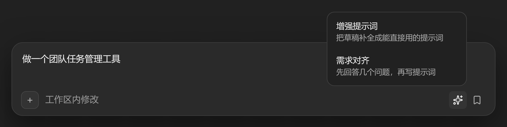
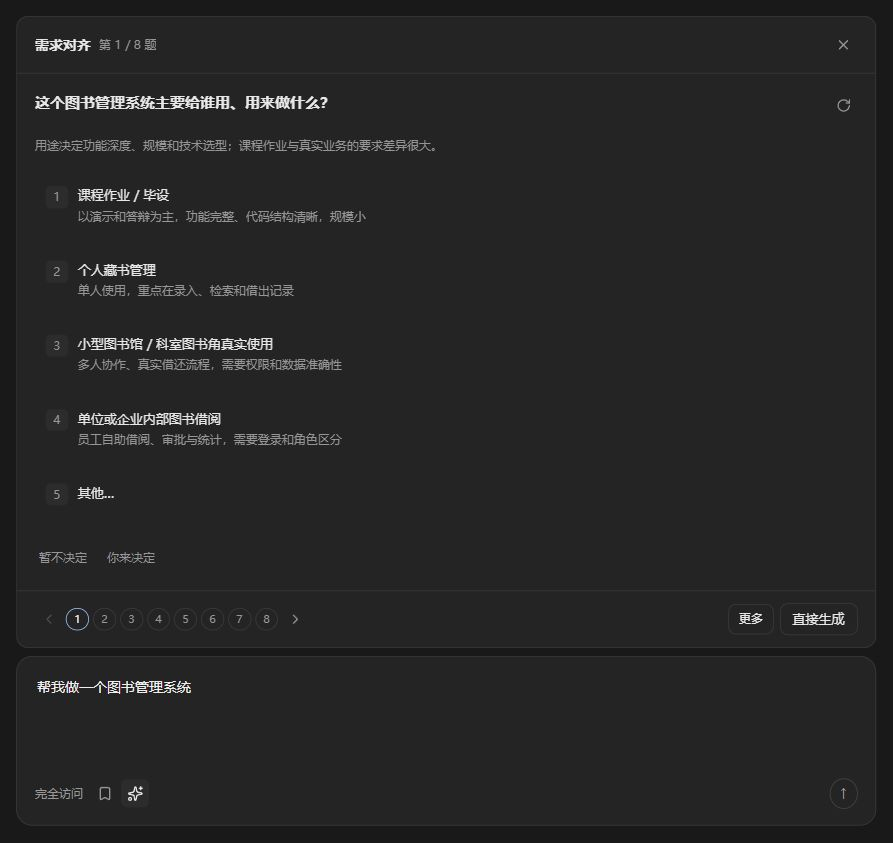
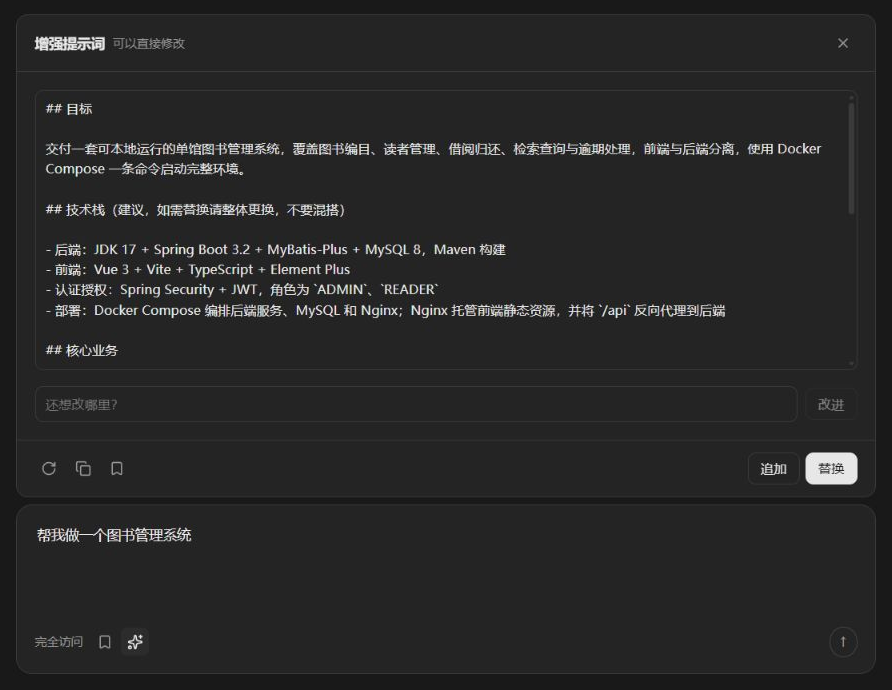
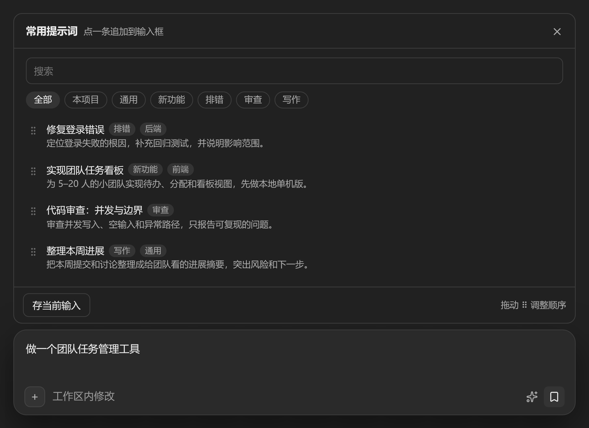

# PromptKit

[中文](README.md) · **English**

Rough draft in, useful prompt out. Ask the missing questions, then keep prompts worth reusing.

A DeepSeek Harness plugin that completes a draft into an actionable prompt, or clarifies the requirements first.



## Install

In Harness, open **Plugins → Add plugin** (arrow) → **Install a third-party plugin**, then paste:

```text
github:nk33-dev/dsh-promptkit#path:/packages/promptkit
```

Enable the plugin and restart Harness. Requires Harness `0.2.1-rc.2`. The repository ships the built output, so Node and pnpm are not required.

For source installs and development, see [Development](docs/development.md).

## Features

- **Enhance prompt**: produces a prompt that an executor such as Claude Code or Codex can act on directly, never a list of questions. Decisions the executor can make are settled; facts only you know become fill-in blanks such as 【list page URL】.
- **Clarify needs**: asks about missing decisions with a recommended choice and rationale for single-choice questions, plus multiple selection, custom answers, “Decide later” and “You decide.” Small facts become blanks instead of extra questions. It generates when the direction is clear and follows up only on ambiguity, conflicts or important gaps.
- **Saved prompts**: live search, tag filters and drag to reorder across sessions. General means untagged. Click a row to append; hover to replace or edit; deletion can be undone.
- **Safe write-back**: edit the result, then append or replace. Replacement can be undone; nothing is sent automatically.
- Optional project context, host or independent model connection, Chinese/English and light/dark themes.

## Usage

Click ✨ beside the composer. With both modes enabled, choose one first; with a single mode it starts immediately.

- In Clarify needs, numbers select choices; arrows and numbered circles navigate questions. Recommendations appear first. Multiple choices are recorded immediately. “Decide later” and “You decide” stay pinned below the choices. Once all answers are complete, use the last question's right arrow to review them; **Generate now** remains available. Use the icon beside a question to have it rephrased.
- **Change answers** on the result returns to the questionnaire; continuing without changes restores the previous result without another model call.
- Use the follow-up field to refine the result. The action bar offers regenerate, copy, save, append and replace.
- Click 🔖 for saved prompts. **Save current input** stores the current draft.

If the draft changes while the card is open, the workflow locks and offers to restart with the new text instead of overwriting it.

## Settings

Open **Harness Settings → PromptKit**.

- Entry switches, default mode, model connection and timeout.
- **Polish / Standard / Detailed** are available in the entry menu, with per-request limits of 5 / 10 / 15 questions. Actual counts are usually lower. Polish only rewords, keeping length and content; Standard fills in goals, core content and key choices; Detailed expands a concrete plan when useful.
- **Audience profile** ranges from no technical experience through P4–P10. It adjusts explanations and guidance, independently of project scale.
- Rewrite and question rules; leave blank to use the built-in rules.
- Project context is off by default. Enable project name, instructions, manifests and directory separately.
- Import/export uses `{"version":1,"favorites":[...]}`, up to 8 MiB and 5,000 entries.

API keys are stored by Harness's credential service; the page only shows whether one is configured.

## Screenshots

Production components replaying captured model output in a test composer; these are not native Harness window captures.

| Clarify needs | Enhance prompt |
|:---:|:---:|
|  |  |



## Development and validation

```sh
pnpm install
pnpm check
pnpm test
pnpm pack:plugin
```

See [Development](docs/development.md) for the module layout and committed build output, and [Validation](docs/validation.md) for automated coverage, real-Harness scope and limitations.

MIT
